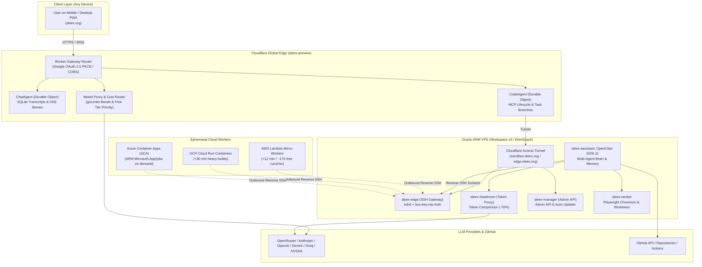
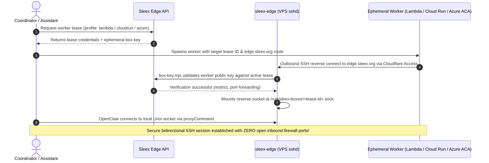

# SLEEX & SLEEX-VPS: Project Documentation & Technical Architecture Deck

> **Role & Perspective:** Technical Architecture & Systems Engineering  
> **Focus & Phase:** Live Multi-Cloud Testing Phase, Dogfooding Benchmarks & System Verification  
> **Primary Asset:** [sleex-presentation.pdf](sleex-presentation.pdf) (18-Slide High-Resolution 16:9 PDF Deck)  
> **Source Deck:** [sleex-presentation.html](sleex-presentation.html) (HTML5/CSS Print Template)  
> **Slide Previews:** [slides/](slides/) (High-resolution PNG renders of each slide)

---

## Executive Summary & Strategic Positioning

**Sleex** and its companion infrastructure harness **Sleex-VPS** represent an architectural leap in autonomous AI-assisted software engineering. 

While legacy dev tools (Cursor, Windsurf) remain tethered to developer laptops, and autonomous platforms (Devin, Codex Cloud, Claude Coworker) force customers into expensive, single-model proprietary walled gardens costing hundreds of dollars per seat, **Sleex** delivers:

1. **Ubiquitous 24/7 Mobile & Desktop PWA:** A zero-install, offline-capable Progressive Web App running on Cloudflare Workers and global edge static assets ([sleex.org](https://sleex.org)).
2. **Autonomous Multi-Agent Engineering Swarm ("Claw Team"):** A coordinated 6-agent roster (Coordinator, Coder, Reviewer, Maintainer, Designer, Professor) running on OpenClaw 2026.11 that turns GitHub issues into tested, reviewed, and merged pull requests automatically.
3. **90%+ Lower Operating Unit Economics:** Powered by lossless **Headroom 0.41 token compression** (saving 40–70% on LLM context tokens), Cloudflare SQLite Durable Objects, and dynamic workload placement leasing ephemeral serverless micro-workers (AWS Lambda, GCP Cloud Run, Azure Container Apps) and Oracle Cloud Always-Free ARM VPS.
4. **Zero Vendor Lock-In & Model Sovereignty:** Intelligent multi-provider proxy with dynamic price-band parsing (`goLimits`), automatic fallback chains, free-tier prioritization (Gemini Flash, Groq, Cloudflare Workers AI), and Bring-Your-Own-Key (BYOK) support.

---

## Presentation Slide Deck Overview (18 Slides)

The complete presentation slide deck is compiled as an engineering-ready, 16:9 widescreen PDF at [`sleex-presentation.pdf`](sleex-presentation.pdf).

### Slide Index & Core Themes

| # | Slide Title | Category | Core Content & Value Delivered |
|---|---|---|---|
| **01** | **SLEEX & SLEEX-VPS: Cover Slide** | Title & Meta | Brand identity, technical architecture overview, live testing focus badge |
| **02** | **Live Testing Phase: Objectives, Scope & Readiness** | Quality & Verification | Dogfooding targets (-92% cost, 24/7 autonomous loop, multi-cloud workers) |
| **03** | **The Problem: AI Coding is Broken, Expensive & Trapped** | Architecture Context | Token bloat, desktop laptop lock-in, proprietary silos, PR review bottleneck |
| **04** | **The Solution: The Sleex Autonomous Studio** | Breakthrough | PWA Edge UI, OpenClaw Autonomous Brain, Hybrid Ephemeral Sandboxes |
| **05** | **Mission & Vision: Sovereign AI Engineering** | North Star | Guiding pillars: Ubiquity, Frugality, Autonomy, Sovereignty |
| **06** | **Tech Stack (Part 1): Edge & Frontend** | Architecture | React 19, TS 7, Cloudflare Workers, ChatAgent/CodeAgent Durable Objects |
| **07** | **Tech Stack (Part 2): VPS & Workspace v3** | Architecture | OCI Ampere ARM64, sleex-edge sshd, sleex-headroom, sleex-manager, OpenClaw |
| **08** | **System Architecture & Traffic Routing Flow** | Flowchart | Complete vector diagram: User PWA → Edge DO → VPS → Workers → GitHub |
| **09** | **The "Claw Team": 6 Specialized Autonomous Agents** | Multi-Agent Swarm | Coordinator, Coder, Reviewer, Maintainer, Designer, Professor roles & loop |
| **10** | **Model Proxy & Headroom Token Optimizer** | Unit Economics | Headroom compression (-70% tokens), `goLimits` price bands, $0.18/PR |
| **11** | **Hybrid Ephemeral Compute: AWS, GCP & Azure** | Virtualization | Dynamic placement (Lambda, Cloud Run, Azure ACA), Zero-trust reverse SSH |
| **12** | **Competitive Landscape: Why Sleex Wins** | Competitive Matrix| Head-to-head vs. Codex, Claude Coworker, Devin, Cursor/Windsurf |
| **13** | **SWOT Analysis: Strategic Evaluation** | SWOT Matrix | 2x2 matrix: Internal Strengths & Weaknesses vs. External Opportunities & Threats |
| **14** | **Identified Gaps & High-Value Opportunities** | Gap Analysis | Multi-tenant SaaS provisioning, PWA live canvas, spend guardrails |
| **15** | **Actionable Product Roadmap (2027)** | Execution Plan | 4-Quarter milestone timeline: Q1 Hardening, Q2 Canvas, Q3 Fleet, Q4 Production |
| **16** | **Live Testing Methodology & Dogfooding Benchmarks** | Testing Phase | Phase 1 Dogfooding, Phase 2 Multi-Cloud, Phase 3 Headroom Verification |
| **17** | **Test Harness, Automated Suites & Verification** | Quality Assurance | Automated test suites (`tests/*.test.mjs`, `azure-worker.test.mjs`, `claw.test.mjs`) |
| **18** | **Live Testing Phase: Conclusions & Next Steps** | Next Steps | Verification roadmap, internal issue dogfooding, and immediate technical milestones |

---

## Detailed Architectural Breakdown

### 1. Edge & Frontend Layer (Sleex Web & Core Services)
- **React 19 & TypeScript 7 PWA:** Served from Cloudflare Workers Static Assets with strict Cache-Control headers (`public, max-age=0, must-revalidate` for `index.html`, immutable hashed assets). 
- **Owner-Scoped SQLite Durable Objects:**
  - `ChatAgent`: Authoritative transcript storage, SSE streaming multiplexer, optimistic UI deduplication using send operation IDs.
  - `CodeAgent`: Remote MCP connection manager, Plan/Review/Build permission state, uncertain-write ledger reconciliation.
  - `MemberDirectory`: System RBAC, GitHub App encrypted private keys, and Web Push event dispatcher.
- **Dynamic Model Cost Router:** Dynamic price tiering (`goLimits`), BYOK token encryption, and model fallbacks from Gemini 2.5 Flash / Groq to Claude 3.7 Sonnet and GPT-4.1.

### 2. VPS & Workspace v3 Layer (Sleex VPS Harness)
- **Oracle Cloud Always-Free ARM Architecture:** 4 Ampere A1 vCPUs, 24 GB RAM, 200 GB NVMe storage, running Ubuntu 24.04 LTS.
- **Hardened Multi-Container Topology (Zero Exposed Listening Ports):**
  - `sleex-edge`: Hardened OpenSSH daemon dropping all Linux capabilities (`cap_drop: [ALL]`, `no-new-privileges: true`). Reached via Cloudflare Access (`edge.sleex.org`). Dynamically queries Sleex API (`box-key.mjs`) to authorize inbound reverse SSH tunnels from leased ephemeral workers.
  - `sleex-headroom`: Dedicated Headroom 0.41 token saver proxy. Eliminates redundant prompt boilerplate and compresses verbose tool call results, reducing token expenditure by 40–70%.
  - `sleex-manager`: Admin API daemon. Handles host metrics, Docker monitoring, container lifecycle, and one-click blue/green stack updates (`updater.mjs`) with 3-minute self-healing rollback.
  - `sleex-assistant`: OpenClaw 2026.11 container. Houses persistent agent memory across sessions, cron jobs, ClawHub skills, and the 6-agent roster.
  - `sleex-worker`: Playwright Chromium sandbox and isolated workspace checkouts.

---

## Interactive Architecture & Workflow Flowcharts

### Flowchart 1: High-Level System Architecture & Traffic Routing



### Flowchart 2: Autonomous "Claw Team" Multi-Agent PR Pipeline

```mermaid
flowchart LR
    Issue["GitHub Issue /<br/>Workboard Card"] --> Coordinator["1. Coordinator (main)<br/>15-min Cron Loop"]
    Coordinator -->|Auto-Triage| Coder["2. Coder Agent<br/>OpenCode SDK 2.2<br/>(Lambda/Cloud Run/Azure/VPS)"]
    Coder -->|Builds & Runs Tests| PR["Draft Pull Request"]
    PR --> Reviewer["3. Reviewer Agent<br/>Gemini Free Tier<br/>Diff & Security Audit"]
    Reviewer -->|Automated Review Checks| Decision{"Approved?"}
    Decision -->|Changes Needed| Coder
    Decision -->|Approved| Maintainer["4. Maintainer Agent<br/>Batch Merge Runs<br/>(12:00 & 20:00 UTC+8)"]
    Maintainer -->|Merges Branch| MainBranch["Production Main Branch"]
    MainBranch --> Designer["5. Designer Agent<br/>Playwright Snapshots & QA"]
    MainBranch --> Professor["6. Professor Agent<br/>Docs & Memory Ledger"]
```



### Flowchart 3: Zero-Trust Reverse SSH Worker Tunneling



---

## Competitor Comparison & Market Positioning

| Feature / Metric | **SLEEX** | **OpenAI Codex** | **Claude Coworker** | **Devin (Cognition)** | **Cursor / Windsurf** |
|---|---|---|---|---|---|
| **Form Factor** | **Mobile & Desktop PWA** | Mac App / Mobile App | Desktop / Web Preview | Web Console | Desktop IDE Extension |
| **Pricing Model** | **Open Source / BYOK / Self-Hosted** | $20–$200/mo ChatGPT | $20–$100+/mo Pro/Max | $500+/user/month | $20/mo + token markup |
| **Autonomous Loop** | **24/7 Swarm (6 Agents)** | Single task runner | Proactive brief checks | Autonomous agent | Autocomplete / Chat |
| **Model Freedom** | **8+ Providers (Fallback)** | OpenAI GPT Only | Anthropic Claude Only | Proprietary Black-Box | User Configurable |
| **Infrastructure** | **Edge + Hybrid Sandboxes** | OpenAI Cloud Env | Claude Computer | Hosted Cloud VMs | Developer's Laptop |
| **Token Optimization**| **Headroom In-line (-70%)**| Proprietary / None | None (Raw Context) | Opaque | Context Pruning |
| **Self-Hostable** | **Yes (VPS / Private Cloud)**| No | No | No | No (Backend is SaaS) |

---

## SWOT Matrix

```
+---------------------------------------------------+---------------------------------------------------+
|                   STRENGTHS (S)                   |                  WEAKNESSES (W)                   |
+---------------------------------------------------+---------------------------------------------------+
| • 90%+ lower operating costs vs. competitors      | • Hybrid multi-cloud setup requires initial setup |
| • Zero-install mobile PWA with full task steering | • Single-tenant deployment model today            |
| • 6-agent autonomous workforce covering full SDLC | • Serverless free-tier quotas cap concurrent runs |
| • Headroom token compression slashing model bills | • Nascent brand recognition vs. venture incumbents|
| • Model-agnostic auto-fallback resilience         | • Dependent on upstream OpenClaw/OpenCode cadence |
+---------------------------------------------------+---------------------------------------------------+
|                 OPPORTUNITIES (O)                 |                    THREATS (T)                    |
+---------------------------------------------------+---------------------------------------------------+
| • Exploding $30B+ AI developer tools market       | • Hyperscalers (Google/OpenAI) price commoditization |
| • "AI Junior Developer as a Service" subscription | • Microsoft GitHub Copilot expanding agent loops  |
| • Enterprise private/sovereign appliance licenses | • Cloud provider free-tier terms & quota changes  |
| • Standalone Headroom token compression licensing | • Breaking changes in LLM vendor API protocols   |
+---------------------------------------------------+---------------------------------------------------+
```

---

## Strategic Actionable Roadmap (2027)

```
2027 QUARTERLY EXECUTION MILESTONES
--------------------------------------------------------------------------------------------------------
[Q1 2027: Enterprise Hardening] ──► [Q2 2027: Mobile Canvas 2.0] ──► [Q3 2027: Multi-Cloud Fleet] ──► [Q4 2027: Production Scale]
 • Automated R2 state backups        • Interactive collaborative canvas  • Auto-scaling worker cluster       • Public self-service multi-tenant portal
 • Hard spend & dollar budgets       • Low-latency WebSockets terminal   • Multi-repo monorepo graphs        • Enterprise private appliance
 • Turnkey multi-tenant orchestrator • Voice task briefing enhancements  • Sentry/Datadog auto-triage        • SOC2 Type 2 certification
 • SOC2 Type 1 audit compliance      • Automated visual Playwright QA    • ClawHub public skill store        • Multi-Cloud Production Scale Achieved
```

---

## Live Testing Phase & Quality Assurance Verification

### 1. Multi-Tier Automated Test Harness
Sleex maintains comprehensive automated test coverage across edge runtimes, durable objects, and cloud worker dispatchers:
- **Core Runtime & Auth Suites (`tests/*.test.mjs`):** Validates Google OAuth 2.0 PKCE login flows, guest access controls, `MemberDirectory` RBAC, `ChatAgent` SSE streaming, and `CodeAgent` branch commit ledgers.
- **Azure Worker Job Controller (`tests/azure-worker.test.mjs`):** Validates ARM API `Microsoft.App/jobs` execution dispatch, OAuth2 client credential renewal via Azure Active Directory, polling transitions, and timeout handling.
- **Worker Profile Drift Verification (`tests/claw.test.mjs`):** Confirms OpenClaw agent profiles stay synchronized across all supported compute backends (AWS Lambda, GCP Cloud Run, Azure Container Apps, and local VPS).
- **Blue/Green Auto-Updater Recovery (`updater.mjs`):** Verifies 3-minute post-deployment health probes with automated rollback to the previous container generation on service failure.

### 2. Security & Zero-Trust Validation
- **Zero Exposed Internal Ports:** Services bind strictly to Unix sockets or the internal Docker bridge. Inbound worker connectivity is mediated through Cloudflare Access reverse SSH authentication (`edge.sleex.org`).
- **Memory Wiki Knowledge Ledger:** The OpenClaw Memory Wiki automatically compiles provenance, claims, and cross-session test history to prevent hallucinated changes.
- **Linux Capability Dropping:** Docker runtimes enforce `cap_drop: [ALL]` with non-root execution (`node:1000:1000`), preventing host filesystem or kernel exploitation.

---

## File Manifest & GitHub Pages Publishing

All presentation and architecture documentation files are published via GitHub Pages:
- **Live Presentation Deck:** [https://pixca-net.github.io/sleex-docs/](https://pixca-net.github.io/sleex-docs/)
- **PDF Download:** [https://pixca-net.github.io/sleex-docs/sleex-presentation.pdf](https://pixca-net.github.io/sleex-docs/sleex-presentation.pdf)
- **Repository Documentation Source:** `sleex-docs/docs`

1. **`index.html` / `sleex-presentation.html`**: Complete HTML5 & CSS presentation source with interactive slide deck, vector SVG diagrams, and responsive layout. Served directly via GitHub Pages.
2. **`sleex-presentation.pdf`**: Master 18-slide presentation deck (16:9, vector text, high-resolution graphics).
3. **`sleex-presentation.md`**: Technical briefing and slide deck transcription.
4. **`slides/`**: High-resolution PNG slide exports (`slide-01.png` through `slide-18.png`).

### Zero-Compile Architecture Updates
Updates to documentation and slides in `docs/` are automatically served live via GitHub Pages without requiring local Chromium PDF/image compilation runs on each update.

---
*Document prepared for Sleex Technical Architecture & Live Testing.*  
*Production URL: [https://sleex.org](https://sleex.org)*
